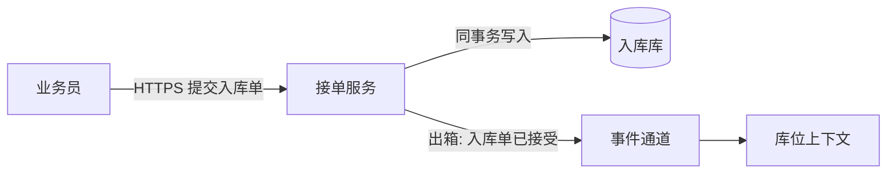

# 视图

先有场景编号，再画图。图不创造决策，只让决策可以被走查。

C4、4+1、Rozanski 与 Woods 的视点、arc42 的章节是同一批关注点的不同名字。同一关注点只留一张图，标题用「它回答的问题」，并在括号里注明对应的视点，避免两套图各画一遍。

| 要回答的问题 | C4 | 4+1 | Rozanski 视点 | arc42 |
| --- | --- | --- | --- | --- |
| 系统外有谁，责任停在哪 | Landscape 或 Context | 场景中的外部参与者 | Context | 第 3 章 |
| 有哪些可独立运行的单元，用什么协议协作 | Container | — | Functional 的运行单元 | 第 5 章第一层 |
| 一个单元内部的职责如何划分 | Component | Logical | Functional | 第 5 章第二层 |
| 数据谁拥有，哪里允许复制，一致性窗口多大 | 无对应层，必须另画 | Logical 里最容易被漏掉 | Information | 第 8 章的数据概念 |
| 峰值、失败、并发时路径怎么走 | Dynamic | Process | Concurrency | 第 6 章 |
| 进程落在哪些节点，网络和地域如何 | Deployment | Physical | Deployment | 第 7 章 |
| 代码如何按仓库和模块放置，依赖朝哪 | — | Development | Development | 第 5 章的模块 |
| 如何发现故障、如何发布、失败域在哪 | — | 经常缺失 | Operational | 第 8 章 |
| 信任边界、认证点和审计点在哪 | 标在 Context 或 Container 上 | 经常缺失 | Security 视角覆在各图上 | 第 8 章 |
| 类、接口、表字段 | Code | Logical 的细节 | 通常不再是架构视图 | 不默认写 |

安全、演进、容量、合规是视角：它们不自动再占一张图，但要能指到已经画出来的元素上。指不到，就补元素或补决策，而不是再声明一个视角。

## 单个系统至少留下

1. 上下文图。外部的人和系统，以及越过边界的关系。关系上写协议和数据，不写「调用」。
2. 容器图。可独立运行或独立失败的单元、主要技术和协议。
3. 至少一条运行时图，走排名第一的质量场景。环境（正常、峰值或故障）写在标题里。
4. 数据所有权图，当关注点清单里的数据项有对应场景时。画谁拥有真相、谁持有副本、窗口多大。
5. 组件图只展开承担最难变化或最高风险的那个容器，不是每个容器一张。
6. 部署图，当部署轴的选择不是「单进程」或可用性、地域、发布是靠前场景时。
7. 开发视图，当团队边界、仓库或依赖方向本身是决策时。

多系统景观至少留下第 1 项，加上系统之间的通信轴和数据所有权。不展开容器内部。

C4 的代码级视图只有决策已经落到跨团队的接口或持久化契约时才画。

4+1 的场景不单独为了凑五张图再画一张。场景写成走查表。逻辑、进程、开发、物理分别对应上表里已经选择留下的那些图。五视图里本次没有的，在走查表后写一行「未画，因为……」。

## 每张图必须有的

- 标题是问题，不是「架构总图」
- 方框是一块责任，能对应到四轴或边界决策
- 箭头标明移动的是同步调用、命令、事件还是数据，并带协议或通道
- 没有场景经过的方框删掉
- 信任边界若存在，画在图上

用 Mermaid 的 `flowchart`。不使用尚未确认能渲染的 C4 专用语法。

## 走查表

排名前三的质量场景，加上一条主功能场景，每条一行：

| 场景 | 路径上的元素 | 出现在哪张图 | 响应度量是否仍成立 |
| --- | --- | --- | --- |

路径缺口、度量被破坏，都是回到结构或决策去改的理由，不是在表里写「基本满足」。
