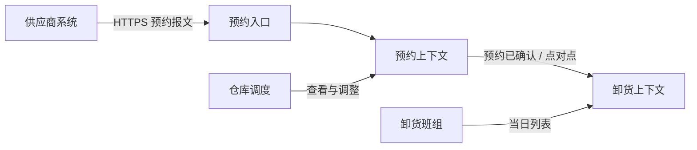
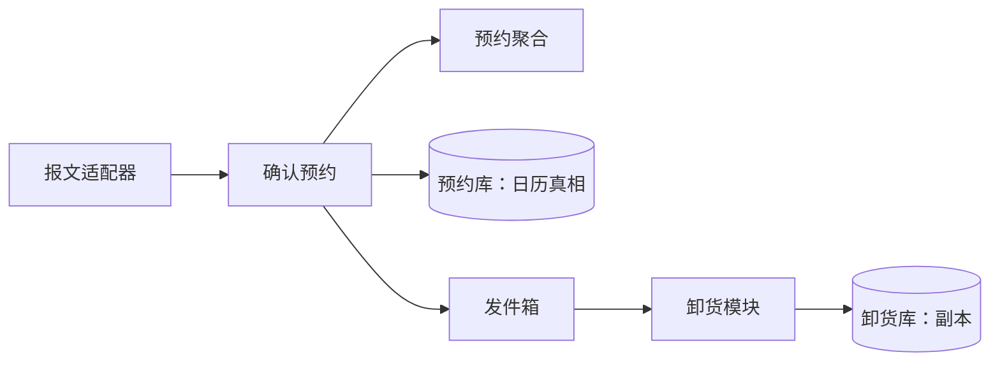
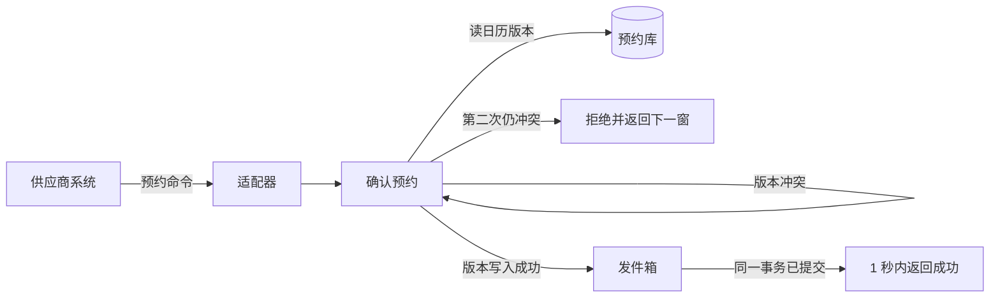

# 例子

这里的业务只用来校准交付长什么样。用户的系统不同，数字、上下文和否决理由都要重算。把「预约」换成别的名字、其余照抄，等于没做架构。

## 例子一

输入只有一段话。合格的交付仍然走完全部九节。

**输入**

我们要做仓储入库预约。供应商提前预约月台，仓库按预约收货。上午是高峰，月台不能堵死。以后可能不止一个仓库。先把系统架构定下来。团队四个人，没有现成代码。

### 1. 高度、干系人、假设

高度是单个系统，不是多仓景观，也还不是类设计。干系人是供应商（要马上知道成没成）、仓库调度（要月台不被双订）、卸货班组（要在车到之前看见预约）、这个四人小队（要守得住发布和故障）。

假设，尚未被用户确认，但是本轮拿来决策的：

- 一个仓库一天大约 300 次预约请求。高峰在 7:00 到 9:00，短时大约每秒 2 次，不是互联网那种每秒成千上万。
- 六个月内会变成 5 个仓库。各仓月台数量和开放时间不同。没有要求每个仓库单独部署、单独值班。
- 供应商侧已有自己的系统，报文格式我们改不了。
- 「不堵死」的操作含义是：冲突时立刻拒绝，并给出该仓下一个可用时间窗，而不是把车先放进来再排队。

合规这一项不适用：没有药品、保税或跨境监管出现在需求里。若后面出现，数据保留和审计要重开。

### 2. 效用树

重要性高且难度高的是 S1 和 S2。它们决定四轴。S3 决定演进时不要提前拆服务。S4 是功能主路径，用来走查，不单独推翻结构。

| 编号 | 场景 | 重要性 | 难度 |
| --- | --- | --- | --- |
| S1 | 来源是供应商系统。刺激是为一辆车预约某仓某月台的一个时间窗。环境是早高峰。制品是该仓的月台日历。响应是成功，或拒绝并返回下一可用窗。度量：95% 在 1 秒内返回；同一个时间窗不会出现两张已确认预约 | 高 | 高 |
| S2 | 来源是进程崩溃。刺激是预约服务在确认写入之后、对外通知之前重启。环境是高峰。制品是已确认预约。响应是重启完成后预约仍在，卸货侧最终能看见。度量：已确认预约零丢失；卸货侧最迟 5 秒内可见 | 高 | 高 |
| S3 | 来源是业务。刺激是六个月内仓库从 1 个变成 5 个，规则不同。环境是同一个四人小队仍一起发布。制品是预约规则。响应是新仓规则不改动其他仓的日历代码。度量：新增一仓不增加运行单元，也不增加值班入口 | 高 | 中 |
| S4 | 来源是卸货班组。刺激是按今天的预约安排月台和人手。环境是正常白班。制品是当日预约列表。响应是列表只含已确认、未取消的预约。度量：与预约真相相比，遗漏为零，延迟不超过 S2 的 5 秒 | 中 | 低 |

关注点清单：

| 关注点 | 结论 |
| --- | --- |
| 功能与语言 | 有两个模型。预约说的是时间窗和月台占用；卸货说的是到达、开始卸、验收。对应 S1、S4 |
| 数据 | 月台日历的真相在预约侧。卸货侧可以有副本，窗口 5 秒，见 S2。预约单保留至少 180 天，这是假设 |
| 通信 | 供应商要在同一次操作里知道成败，所以创建预约是同步的。卸货侧不必等在供应商的那一次请求里 |
| 失败与容量 | 峰值约每秒 2 次。外部供应商报文失败不能把月台日历拖死 |
| 安全 | 供应商只能预约自己的送货；调度能看本仓全部。信任边界在对外入口。细的身份方案还没约束，先假定入口鉴权，不把供应商身份扩散进领域规则 |
| 观测 | 要能看见 S1 的 1 秒是否还成立，以及双订次数是否为零 |
| 演进 | 最可能的变化是仓的数量和每仓规则，见 S3。其次是供应商报文格式变化 |
| 团队与发布 | 四人，一个发布单元。对应 S3 的度量 |
| 成本 | 不能为了 5 个仓引入一套编排和多套值班 |
| 合规 | 不适用，原因见上 |

### 3. 四轴

边界先切。预约上下文拥有月台、时间窗、预约单。卸货上下文拥有到达和验收。关系是客户-供应商：卸货依赖预约的确认事实，预约的计划可以排进自己的模型，但不把验收规则写进预约。否决共享内核：两边的词汇不同，共享会把「验收合格」漏进日历。否决各行其道：S4 要求卸货看见预约，两边不是无关的。

结构轴留下模块化单体：一个发布单元里两个模块，依赖只能从卸货指向预约的已发布契约，不能指向预约的日历表。否决微服务：S1 要求同一时间窗即时不双订，拆成服务后这个不变量要跨网络；S3 又禁止为五个仓增加运行单元和值班入口。否决分层单体把两套语言叠在同一组服务里：规则变化频率不同，会互相修改。

通信轴上，创建和冲突检查是同步请求-响应，因为 S1 的 1 秒和「立刻拒绝」都在同一次调用里。预约已确认用事件通知，事件只带预约号和仓号，卸货侧回查预约契约。否决事件携带状态：月台规则会变，事件里的快照会变成第二份日历。否决共享数据库：卸货会开始直接改时间窗。对外供应商报文也是同步的，但是在入口适配，不进通信轴的主干。

数据轴留下「各自拥有数据，跨上下文最终一致」。预约库是日历真相，一次事务只改一张预约聚合。卸货库最多落后 5 秒。否决单一模型：验收和日历不是同一个不变量。否决事件溯源：没有重放和审计法规，状态就是真相，多一条事实日志即可，不必用事件重建日历。否决 CQRS：读写形状还没有分开，S4 就是预约的一种查询。

部署轴留下单进程。两个模块一次发布，一个失败域。否决容器编排：运行单元只有一个，平台成本直接违反 S3 的度量。否决按仓拆进程：需求里没有「一个仓坏了其他仓还要预约」这条场景；若以后有，重开部署轴。

### 4. 边界

```text
供应商系统 --报文--> 预约上下文 --确认事实--> 卸货上下文
                         |
                         +-- 拥有月台日历（真相）
卸货上下文拥有到达、卸货、验收，不拥有时间窗
```

上下文关系：客户-供应商。契约是「按预约号读取一张已确认预约」，加上「预约已确认」通知。

### 5. 模式族

- 创建族：没有这类问题。预约不是一族要配套创建的对象。
- 结构拆分：入口用适配器，把改不了的供应商报文翻译成预约命令。放弃桥接：没有「抽象」和「实现」两个同时增加的维度，增加的是报文格式这一个变化点，适配器够用。放弃外观包住全部业务：调度需要看见冲突原因，不能只留一个粗粒度入口。
- 行为协作：预约单用状态，阶段是已请求、已确认、已取消、已过期，每个阶段允许的操作不同。放弃观察者来通知卸货：那会跨进程、要留存，已经是通信轴上的事件通知。放弃策略对象堆出仓库差异：差异先放在「每仓一份日历规则」的数据里，直到规则的代码路径真的分叉。
- 领域模型：聚合是「一个仓库的一张预约」，边界内包含它占用的时间窗。一次事务不改两张预约。用仓库按预约号取回。工厂不需要，不变量在确认这个行为里。关系不再重复。放弃事务脚本：冲突检查和状态迁移已经是同一套规则，脚本会在查询和确认两处各写一遍。
- 数据访问与一致性：同一时间窗的并发确认用乐观锁，版本冲突就重新读日历并再次尝试一次；第二次仍冲突则按 S1 拒绝。确认写入和「预约已确认」事件用发件箱，避免 S2 那种写成功但通知丢失，或通知发出但写入回滚。放弃 Saga：不变量没有跨两个数据所有者。放弃悲观锁：冲突应很少，锁跨过人的思考时间会把高峰的 1 秒用掉。
- 集成与弹性：只有一条点对点通道，消费者是卸货模块，处理失败进死信，不能堵回日历。供应商报文客户端加超时，预算放在 S1 的 1 秒里面，超时就拒绝本次预约而不是挂住线程。放弃发布订阅：没有第二个消费者。放弃断路器把日历调用一起断开：日历是自己的库，不是外部依赖。放弃 BFF：只有一种对外入口。
- 演进族：没有旧系统，绞杀者和分支抽象都不适用。

### 6. 视图与走查

上下文图回答「责任停在哪」。



容器图回答「哪些东西会一起失败、一起发布」。本方案里入口、预约模块、卸货模块、发件箱转发是同一个进程里的模块，不是四个容器。数据库分成两套所有权，仍是这个进程访问。部署轴是单进程，所以不另画一张只有一个盒子的部署图。未画部署图，因为物理节点不是决策。未画每个模块的组件图；下面只展开预约模块，因为它承担 S1。



运行时图回答 S1 在高峰、发生冲突时怎么走。标题里的环境是早高峰。



数据所有权：预约库持有日历真相和发件箱。卸货库持有预约号、仓号、时间窗副本，不持有版本，不能凭副本去确认新预约。窗口是转发延迟，目标不超过 5 秒。

| 场景 | 路径 | 图 | 度量是否仍成立 |
| --- | --- | --- | --- |
| S1 | 供应商系统、适配器、确认预约、预约库版本；冲突则同路径再试一次后拒绝 | 运行时图 | 成立的条件是外部报文超时单独预算，例如 300 毫秒，剩下留给库。这个预算是敏感点 |
| S2 | 确认写入与发件箱同一事务；进程重启后转发器继续投递；卸货写入副本 | 容器图 | 成立。若有人改成「写库成功再发消息」且不在同一事务，S2 失败 |
| S3 | 新仓是预约库里的另一份日历规则，仍进同一个确认路径，不新增进程 | 容器图 | 成立。规则一旦需要独立代码部署，S3 的度量被打破，要重开结构轴 |
| S4 | 卸货班组读卸货库副本，副本只来自已确认事件 | 上下文图、容器图 | 成立，延迟看 S2 的 5 秒 |

未画 C4 代码级视图：跨团队的接口还只有「预约号查询」和「预约已确认」，没有到字段级的契约谈判。未画 4+1 开发视图：仓库只有一个，依赖方向已写在结构轴里。

### 7. 决策记录

**ADR-1 模块化单体，而不是按仓或按上下文拆服务**

- 状态：已接受
- 上下文：S1 的即时不双订，S3 的单发布单元，四人小队
- 方案：模块化单体；按上下文拆两个服务；按仓库拆五个服务
- 结果：模块化单体
- 后果：S1 和 S3 变容易。变难的是以后若出现「一个仓的故障不能影响其他仓」，现在的单进程做不到，那条新场景会推翻本决策
- 证伪：高峰期双订次数大于零，或新增第三个会独立发布的模块

**ADR-2 预约聚合加乐观锁，发件箱通知卸货**

- 状态：已接受
- 上下文：S1 的冲突，S2 的零丢失和 5 秒可见
- 方案：乐观锁加发件箱；悲观锁；写库后直接调用卸货
- 结果：乐观锁，冲突重试一次；发件箱与预约写入同一事务
- 后果：高峰的重试可能吃掉 1 秒预算。直接调用会让卸货故障变成预约故障，S1 变差
- 证伪：因版本冲突导致的超时比例让 S1 的 95% 失守；或出现已确认但不在发件箱、卸货永远看不见的预约

### 8. 风险、敏感点、取舍、证伪

- 敏感点：报文超时预算、乐观锁重试次数、发件箱转发延迟、聚合是否被放大成「整仓日历」。
- 取舍点：把创建预约改成异步可以保护高峰吞吐，但 S1 的「1 秒内知道成败」失败。按仓拆服务可以隔离故障，但 S3 的运行单元数量和 S1 的即时一致一起变差。
- 风险：每秒 2 次和 300 毫秒报文预算都是假设。假设偏低时，S1 的 1 秒没有依据。这是开放项，不在没测量时改成微服务。
- 非风险：五个仓的规则不同。只要规则还是同一条确认路径上的数据，S3 不要求新的运行单元。
- 适应度：上线后统计双订次数（必须为 0）、预约接口的 95 分位延迟（必须小于 1 秒）、发件箱最老未投递年龄（必须小于 5 秒）。三条里任何一条持续破线，重开 ADR-2；若破线原因是单进程容量而不是锁，再重开 ADR-1。
- 有现状：没有代码。这一节不适用，不编造模块。

## 例子二

同一系统的下一句话。这是修改，不是新开一份架构。

**输入**

别搞单体了，每个仓库一个微服务，以后才扩展得动。

**合格的回应**

理解成一条新的关注点：仓和仓之间要能独立扩展。现有场景里没有它。S3 写的是五个仓、仍是一个小队、不增加运行单元。S1 要求双订在一次事务里失败。

保住结构轴的改法：日历按仓库分区，确认路径仍在一个进程里。扩展的是数据划分，不是部署单元。独立扩某一仓的容量，目前没有场景支持。

若坚持每个仓库一个服务，结构轴和部署轴都要改，通信轴上的「同步确认」会变成跨服务占用时间窗。S1 的即时不双订不再成立，除非再引入分布式锁或把预约收成一个中央日历服务，那五个仓库服务就不再拥有日历。ADR-1 被取代。运行时图作废，要按「中央日历加仓服务」或「分布式锁」重画，并重走 S1、S3。

故意不改的是数据真相仍在预约侧，以及卸货不直接写日历。用户没推翻这两条。

开放风险：用户还没承认 S3 的度量作废。在承认之前不开始拆服务。用户第二次明确说「接受双订检查变成最终一致，也接受五个值班入口」，才改轴。

## 例子三

下面这段不合格。它用了本技能里的词，但没有一个能验证的结构。

> 采用领域驱动、事件驱动和数据驱动的微服务架构，结合桥接、观察者和发件箱，画出 C4 四级和 4+1 五视图，保证高可用、高扩展、低耦合。

缺的是：没有一条带度量的场景；三个「驱动」被当成了一个口号，没有分别落到边界、通信和数据；桥接没有变化轴；五视图没有哪条路径在回答冲突时的 1 秒；没有否决，也没有证伪。出现这种段落，删掉重做第 1 步，不要在后面补图把它妆点成完成。
